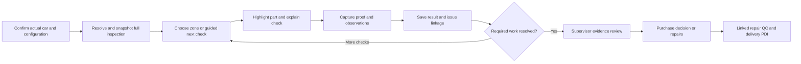

# Data-led vehicle operations and spatial inspection plan

30 October 2026 · Approved direction with first implementation in progress · Supersedes the standalone motion-study direction

Implementation update: the first slice now imports searchable name references,
resolves the 246-definition unapproved pre-purchase library, snapshots tasks
above 200 checks and connects section/part navigation, a complete searchable
list and bundled generic car models to the same proof/result flow. Following
owner feedback, the crude procedural geometry was replaced with CC0 meshes;
the car supports drag rotation and projected red points, with a part picker
when nearby points overlap. Sections remain the default entry. Current results
and remaining gaps are in [development status](../DEVELOPMENT_STATUS.md) and
[verification](review/VERIFICATION.md). Proposed features below are not all
implemented or accepted.

## 1. Product direction

Build the interactions into the real work. The centrepiece is a **guided spatial inspection**: identify the actual car, load its applicable inspection, show a shared 3D body model, highlight the next part, capture evidence, record a result, and carry that finding into purchase decisions, repairs, QC, delivery and warranty. The owner sees the same vehicle record with company-wide evidence, cost, accountability and completion information.

The master catalogue, approved inspection knowledge and operating history live in the company's database and versioned offline packs. AI retrieves from this knowledge; its remembered facts do not establish vehicle configuration or inspection completion.

This is **one internal company application**, with individual staff accounts and combinable responsibilities. Keep existing company IDs as a data namespace, existing staff permissions and the owner's full access. No tenant selector, SaaS subscriptions, multi-company onboarding or marketing exchange is required.

## 2. Starting point before this implementation

The backend's seeded training tasks contain **three** items in `apps/api/app/seed.py`. Separate draft templates in `apps/api/app/checklists.py` contain 14 pre-purchase, 9 intake, 3 repair-QC and 8 delivery items. Those are unapproved starters. A separate motion demo also displayed three sample checks.

The current item contract contains an ID, bilingual title/instruction, order and required flag. An answer is currently OK/problem with one required photo reference. It lacks a canonical component, location, applicability rule, typed measurement, full result vocabulary and spatial asset binding. Checklist creation currently caps item count/order at 200. Vehicle records currently store free-text make/model/year rather than a generation/variant catalogue reference. These are concrete extension points, not a complete inspection product.

[Arihant's website](https://www.arihantcars.com/) advertises 151 checkpoints but does not expose an itemized SOP in the inspected page. We must not represent an invented list as Arihant's existing 151-point standard. Prepare a comprehensive proposed library, reconcile it with the actual company procedure, and version the approved result. The count is a coverage requirement, not an aesthetic target: equipment-specific checks can legitimately change the final applicable count.

## 3. The employee flow



1. **Confirm the car.** QR or stock number opens its photo, registration, make/model/generation, manufacture year, fuel and transmission. Suggest a catalogue match, show ambiguity and ask for a simple confirmation. Registration year is not automatically manufacture/model year. Store the vehicle's observed equipment and modifications as well as expected factory equipment.
2. **Load the complete inspection.** A deterministic resolver applies the approved base, vehicle configuration, inspection stage and company policy. Snapshot the resolved item set, rule reasons and catalogue/template versions. No screen limits the inspection to a demonstration subset. Unknown equipment creates a verification step rather than silently suppressing checks.
3. **Show the inspection map.** Phone: 3D car above the current check and fixed large actions below. Tablet: car/zone map left, current instruction/evidence/result right. Visible zone buttons include Exterior, Cabin, Powertrain, Underbody and Test/Documents. A persistent All checks button opens the complete grouped list with search and Remaining/Issues/Needs help filters.
4. **Guide one check at a time.** Tap a zone or Next. The view aligns to the part, outlines it, displays a familiar example image and offers a short spoken instruction. Left/right always mean the vehicle's physical left/right, with the front direction visibly indicated. Employees need no 3D gaming skills; Front/Rear/Left/Right/Inside/Underbody buttons provide direct views.
5. **Capture the right proof.** Photo, short clip or instrument/diagnostic result is required according to that item. Close/pause the 3D rendering while using the camera. The capture is already bound to car, inspection, check and part. Preview/Retake/Help are visible. Preserve existing mobile-side Full HD maximum photo and 720p video policies and server validation.
6. **Record the observation.** Large illustrated choices: Good, Issue, Cannot check, Need help. Measurements appear only where relevant. Not applicable is a separate rules/authorized-review process with a recorded reason. Failure, inability to inspect and missing evidence remain distinguishable. A photo by itself never records a pass.
7. **Continue with saved work.** The thumbnail settles into the check after durable local save. Saved on phone, queued, server received and supervisor accepted are distinct. Choose Next nearby check to reduce walking. An inspector can switch zones and resume at the exact unresolved check after an app restart.
8. **Review the whole vehicle.** Zone badges show completed/required plus separate issue and blocker counts. A completed failed check contributes to coverage but remains an unresolved condition issue. The review identifies every outstanding item; submission/readiness are decided by server rules, never by whether the model looks green.

Pins are clustered by zone/component. Do not show 151 overlapping labels. Only the active group and important exceptions are prominent; individual checks are reachable through the pin's list and All checks. Non-spatial items such as ownership documents, OBD results and road-test observations use clear system cards.

## 4. India vehicle master data

### Coverage

Cover Indian-market passenger vehicles across all makes, current and discontinued models, their generations/facelifts and variants. Include imported cars handled by Arihant, with market/steering distinctions when known. Legacy and low-volume makes must not disappear because they are no longer on a new-car website. The catalogue supports sedan, hatchback, SUV/crossover, MPV/MUV, van, coupe, convertible, wagon and pickup classifications even while the initial shared meshes are three body families.

Use two explicit coverage measures: **brand/model/generation coverage** and **verified variant/feature depth**. A model name existing does not prove all its years and trims are covered. Do not claim a verified all-India catalogue from an unverified scraped list.

### Acquisition and refresh

| Layer | Source and use | Control |
| --- | --- | --- |
| Structured catalogue | Evaluate an India-specific licensed feed/export. [Autorox](https://www.autorox.ai/developers-api) advertises 25,000+ make/model/variant/year records and an internal-application API. This is a provider claim, not independently established complete coverage. | Obtain sample/export schema, source/coverage dates, discontinued/import coverage, update method and permission for internal storage/offline use. No provider selected or purchased by this plan. |
| OEM reference | Validate vehicle facts using Indian OEM brochures and owner references, including [Maruti manuals](https://www.marutisuzuki.com/arena/car-manuals) and [Hyundai India manuals](https://www.hyundai.com/in/en/connect-to-service/hyundai-service/owners-manual). | Field-level provenance, document/model-year scope and human-reviewed extraction. Store only content/assets we are entitled to store; a public page is not automatically an unrestricted bulk dataset. |
| Coverage discovery | Manufacturer directories such as [SIAM members](https://www.siam.in/about-us/members), OEM archives, dealer inventory and known legacy/import entries. | A discovery list is not an exhaustive verified variant database. Reconcile named gaps. |
| Company corrections | A known car or missing trim can be added as a provisional catalogue record with the observed evidence. | Supervisor/owner confirmation, alias mapping, no overwrite of authoritative source or previous inspection snapshots. |

Import into staging, normalize names, deduplicate generations/aliases, validate units and year ranges, produce a diff and publish a catalogue revision. Refresh on a schedule permitted by the source and track new/discontinued/corrected records. Never overwrite an earlier car's observed configuration or inspection history after an upstream change.

Normal inspections read from our PostgreSQL catalogue and downloaded packs; they do not depend on a live catalogue provider call. Licences must permit this use. If no suitable feed is chosen, the same importer can publish verified OEM/company-curated records, with completeness honestly reported. This route takes more curation; it is not equivalent to already having all variants.

Registration lookup is a **separate optional adapter**. Do not plan a public bulk VAHAN scrape as the catalogue source. The [MoRTH data-sharing policy](https://morth.nic.in/sites/default/files/circulars_document/Data-Sharing-policy-20082025-merged.pdf) describes governed access; authorized access and applicable terms would need separate evaluation. No RC-owner data is needed to build make/model/body metadata.

### Core model

```text
Make → Model → Generation/Facelift → VariantRevision
                                ↘ Equipment facts / applicability
Body type → Shared mesh + geometry preset → Semantic component anchors
Actual vehicle → Catalogue match + observed configuration + provenance
```

Store stable IDs; aliases/spelling; market; manufacture/model-year validity; body type; fuel/powertrain; gearbox; drivetrain; engine where relevant; seating/door layout; steering orientation; fitted equipment; verified reference specifications/units; source and verification timestamps. Feature facts use present/absent/unknown, scoped to the right variant revision. Factory CNG and retrofit CNG, for example, are distinct configurations.

A provisional match may allow universal checks to start. Configuration-dependent checks stay visible as verification/blocker work according to policy. Staff must not be forced to select a wrong trim just to continue.

## 5. Three shared 3D assets

Author three coherent, company-owned inspection assets: sedan, hatchback and SUV. Use restrained materials with Arihant red for selection and existing Garage branding. A neutral body color keeps condition states legible. Meshes should be suitable for inspection diagrams, not advertising renders.

Each asset needs separately addressable panels, wheels/tyres, lights, glass, mirrors, doors, bonnet, boot/tailgate, cabin and a schematic engine/underbody layer. Stable semantic IDs such as `wheel.front_left`, `door.front_right`, `glass.windscreen`, `body.front_bumper` and `system.brakes` bind checks to geometry. Keep coordinate convention, anchor position, camera preset, visibility/occlusion rules and supported body configurations in a versioned manifest.

Use body presets for proportions, door count and seating where useful. Keep **actual catalogue body type** separate from the rendering family. An MPV may initially use a clearly labelled extended generic schematic, including a third-row inspection view; it must not be reclassified as an SUV. Coupe/convertible/van/pickup cases need explicit alternate diagrams or later dedicated geometry when the shared schematic would hide relevant components. Unrepresented roof/bed/row checks remain available in the complete list.

Always identify the asset as a generic inspection model and keep the actual car photo/name visible. It is not a manufacturer-accurate digital twin, a source of measurements or proof of the actual car's equipment. No internet download of one 3D model per trim is required.

## 6. Complete inspection knowledge

Author the full library as data, then reconcile the approved Arihant standard. The existing 3/14-item fixtures do not qualify. Do not pad a checklist to exactly 151 or omit equipment just to hold that number.

| Inspection family | Required scope to author and review |
| --- | --- |
| Identity/history/documents | Registration and physical identifiers, ownership references, manufacture/configuration, odometer/service-history observations, document discrepancies and clearance links |
| Exterior/body/structure | Every applicable panel, door, sill, roof, pillars, seams, visible structural areas, finish/damage/repaint indicators and water/corrosion findings |
| Glass/visibility | Windscreen and other glass, each mirror, wipers/washers, visibility controls, fitted cameras/sensors |
| Wheels/tyres | Each road wheel and spare/repair kit: size/fitment reference, tread readings, sidewall/age markings, wheel damage, pressure/TPMS where fitted |
| Engine/powertrain | Applicable fluid observations, leaks, cooling, starting/idling, mounts, intake/exhaust and accessible associated components |
| Gearbox/driveline | Manual/AMT/AT/CVT/DCT-specific observations, clutch where applicable, shafts/joints, engagement and leak findings |
| Brakes | Wheel-specific accessible components, fluid observations, parking brake and controlled functional checks |
| Steering/suspension/underbody | Steering operation, joints/bushes, springs/dampers, accessible underbody/rails, mounts, boots and corrosion/leaks; lift access recorded |
| Electrical/lighting | Required exterior/interior lamps, starting/auxiliary battery observations, charging checks by qualified staff, switches and fitted equipment |
| Cabin/HVAC/features | Every seating row, upholstery/trim, door/window/lock operation, instrument controls, AC/blower/heating and infotainment/equipment |
| Safety/restraints | Belts/buckles by seating position, restraint warnings and visible condition, child-seat anchors where fitted, horn and other applicable safety equipment |
| Diagnostics/road test | Scan evidence when supported, warnings and readiness context, controlled driving observations, braking/steering/shift/noise findings, before/after odometer |

Conditional modules cover EV/hybrid, CNG/LPG, AWD/4WD, turbo-diesel after-treatment, ADAS, sunroof/convertible roof, third-row and premium equipment. Verification of ADAS function/calibration and high-voltage conditions requires qualified procedure and equipment; a photo of a camera or battery casing cannot establish it. Unknown equipment is never silently considered absent.

Each definition contains:

- Stable check and component IDs; inspection stage; applicable locations/repetition such as each wheel/seat/door.
- Short localized title, illustrated/spoken instruction, method, employee/mechanic skill requirement and escalation path. English/Hindi exist today; the pack design also supports company-approved local languages such as Marathi.
- Deterministic applicability/preconditions/dependencies; source; author/reviewer; immutable revision and effective date.
- Evidence requirements: view, minimum photos/clips, readable labels, instrument attachment/measurement, units, capture origin and allowed reuse.
- Result vocabulary, severity, issue classification, recheck policy and readiness effect. No unsupported universal mechanical threshold; tolerances reference the verified OEM/procedure version or require qualified review.

Resolve repeated positions into separately accountable check instances. Keep evidence attachments many-to-many with **explicit per-check binding** when a genuinely suitable photo covers several items. Each item still needs its own observed result; reusing an unrelated image is not acceptable evidence. A shared clip can reference relevant time ranges. Capture guidance for driving work must not require the driver to handle the phone; use a passenger, stationary observations or the approved test record.

Keep observation, review and repair resolution separate. A failed inspection finding remains in history after the linked repair passes QC. Repair QC focuses on the repaired component plus required dependent/safety checks; delivery PDI is its own resolved inspection, not a silent copy of purchase results.

## 7. Data, rules and evidence architecture

**PostgreSQL remains the brain; Python/FastAPI remains authoritative.** Relational IDs and foreign keys link vehicle catalogue, actual vehicle, components, check definitions, approved template revisions, applicability rules, inspection snapshots, per-check instances/attempts, typed readings, evidence bindings, review decisions, findings, repair/QC and warranty records. JSONB holds versioned declarative parameters/manifests where useful; it does not replace referential integrity or become arbitrary executable rules.

Keep four clear knowledge layers: external/reference vehicle facts; company-approved inspection procedures; actual observed evidence/history; derived operational reporting. Every derived conclusion links back to its inputs. Store money, odometer and physical measurements using explicit units/appropriate numeric representations.

The server resolves and validates applicable work, required proof, review and readiness. Mobile can run the same published rules for offline guidance, but reconciliation revalidates authoritative constraints. Catalogue/rule updates affect new inspections; explicit reassessment creates a new version for existing work rather than changing history invisibly.

The current whole-task version model needs deliberate expansion for parallel work. Use a parent inspection and zone/skill assignments with check-level attempts/version checks so two staff inspecting different zones do not overwrite one another. Only the assigned actor can post ordinary work; takeover/reassignment and owner self-review stay attributed. Preserve idempotent commands, audit/outbox patterns and append-only superseded evidence.

Mobile SQLite stores the assigned work pack, resolved checks, asset/voice manifests, durable answers and upload queue. Originals/prepared media, normalized hashes and bindings survive restart and are cleaned according to existing retention policy. Late sync never attaches evidence to a different check, car or rule revision. Evidence uploaded and accepted remain separate states.

Keep the 3D renderer in presentation behind a small spatial-view contract. It receives the selected component and derived status; tapping a component emits a selection. It never writes results, decides applicability, approves a repair or owns durable drafts. List and 3D views consume identical check instances. A tested 2D diagram/list fallback preserves every action.

## 8. Motion and themes within the existing work

| Current flow | Interaction that explains the work | Boundary |
| --- | --- | --- |
| Garage | Keep the existing journey-car stage navigation. A selected car opens its own operational record. | Do not turn that car animation into the universal transition. |
| Inspection | Selecting a zone aligns the 3D view once; the target outline and instruction arrive together. Door/bonnet or layer reveals explain where to look. On evidence save, a thumbnail settles into the check. | No idle rotation, 151 flashing pins, repeated full-car spins or artificial completion. Reduced motion uses immediate preset views. |
| Repair/workshop | Highlight the actual issue's component. Present diagnosis, part/work order, waiting reason and before/after evidence at that location. | A schematic part highlight cannot establish exact spare-part fitment. Missing parts are described explicitly. |
| Supervisor review | Jump from a problem in the queue to its pin, proof, employee result and repair/QC chain. Compare before/after in place. | Approvals are explicit, version-bound commands. Animation never approves. |
| Owner overview | The selected car's coverage map switches between unfinished checks, findings, repair state and warranty history. Choosing a hotspot shows cost, assignee, blocker and next action. | Show completion and condition separately; avoid one unexplained health percentage. No fabricated predictive resale score. |
| Purchase/sale | Keep valuation, evidence, documents and commitments grouped around that vehicle; source panels expand in context. | No casino-style money counters or visual effects that hide obligations. |
| Delivery/warranty | Complete final PDI and show the accepted evidence. An optional brief owner milestone follows confirmed delivery. A later complaint opens the historical component timeline. | Celebration does not replace release gates; warranty history never rewrites earlier evidence. |

Keep the website logo/red/black/white and selected Garage typography. Make context legible through information/layers: inspection is a readable part diagram, workshop is work/evidence, owner is a business overview. A high-contrast outdoor mode can use the same identity. Avoid changing the whole theme every tab or depending on color alone.

## 9. Lightweight AI and sensors

Prioritize speech-to-structured draft notes, approved-instruction explanations in the worker's language, OCR suggestions for visible identifiers/readings, missing-proof prompts and source-linked owner summaries. A compact text model sees only the relevant approved instructions and evidence metadata/observations. People confirm extracted fields and decisions. Evaluate image and speech adapters independently; the existing failed image-quality experiment is not an accepted inspection capability.

Use local camera/exposure/blur hints and motion sensors for steadiness where supported. These are capture assistance, not proof of a specific car part or defect. A model/body preview cannot certify pose. An optional voice command such as “rear left tyre” resolves to a visible component/check selection and gives confirmation; it does not silently pass checks. Useful owner questions include “which cars have unresolved brake findings?” with links to the actual findings and jobs.

Do not make inspection depend on always-on AI, online 3D asset fetching, AR tracking, photogrammetry or automated mechanical diagnosis. The complete manual/voice-guided flow must work with AI unavailable. No vector database is required to start: typed catalogue queries and PostgreSQL search cover the core; add retrieval only for approved, source-linked reference passages when justified.

## 10. Technical feasibility and budgets

[Expo GLView](https://docs.expo.dev/versions/latest/sdk/gl-view/) is included in Expo Go. [React Three Fiber's native renderer](https://r3f.docs.pmnd.rs/getting-started/installation) documents Expo GL/asset support and pairs Fiber 9 with React 19. Candidate stack: `three`, `@react-three/fiber/native`, `expo-gl`, `expo-asset`, versioned glTF/GLB assets. Validate the exact current Expo 58/React Native dependency combination before committing. Existing native media processing still has its own development/installed-build requirements; basic GL availability does not establish full-app Expo Go parity.

Use a small measured feasibility slice inside the real Task screen. Proposed starting budgets, to be profiled rather than promised: one car scene, roughly 20–40k visible triangles, simple lighting, no real-time reflections, assets a few MB per body family, no continuous rendering while idle, pause/release the renderer for camera/background use. Target stable 30 fps during navigation on the agreed lower-end Android test device and prompt selection feedback; measure memory, battery, load latency and recovery. Render even if texture/asset upgrades fail; always retain the functional list fallback.

GLB compression/texture formats must be selected after native loader validation; do not assume web WASM/decoder support in Hermes. Cache/bundle the three essential models with a manifest and hash. Downloaded optional updates cannot invalidate an active inspection. Physical iPhone/iPad verification is required; the R3F documentation specifically cautions about iOS simulator OpenGL reliability.

## 11. Build order within the one full release

| Stage | Concrete output | Acceptance before proceeding |
| --- | --- | --- |
| 1. Data foundation | Catalogue schema/import staging, aliases/provenance/coverage report; full proposed inspection library and semantic component taxonomy; existing stock mapped to verified/provisional entries | Named gaps visible; actual Arihant SOP reconciliation tracked; no fabricated variants or silently unknown features |
| 2. Inspection engine | Applicable-check resolver, repeated positions, rich results/readings/proof policies, immutable snapshots, complete list/zone navigation and honest progress | All assigned checks reachable; missing evidence/unknown/blocked/N/A cannot falsely complete; no 200-item UI/contract assumption |
| 3. Integrated spatial slice | Generic SUV and component manifest inside an actual full Sonet inspection; camera/evidence/result/resume/review connected to existing backend | Same check IDs/results in list and 3D; real proof saved; camera transition/restart/offline safe; no three-check substitute |
| 4. Body and catalogue breadth | Sedan/hatchback/SUV assets and body presets, legacy/import catalogue handling, conditional modules and alternate diagrams | Test actual catalogue combinations across all mapped body types; feature differences produce the right work |
| 5. Lifecycle links | Finding → approval/purchase assessment → workshop/part → targeted QC → delivery PDI → warranty history; owner component/cost/blocker view | Every displayed conclusion links to actual evidence/actors/events; existing financial/readiness gates remain enforced |
| 6. Acceptance and release | Staff comprehension sessions, low-end device profiling, phone/tablet Android and iPhone/iPad checks, data audits and documented fallback | Signed business SOP, complete applicable-check/evidence accounting, device acceptance and all existing full-release gates |

These are implementation stages, not separate partial launches. A paid data feed or exact SOP approval may be pending while schema, curation tooling, draft authoring and the native feasibility slice proceed. They must not be represented as finished approved data.

## 12. Acceptance cases that prove the direction

- Current Arihant stock spans newer mass-market vehicles, a 2010 BMW sedan, luxury imports, Ford Endeavour and an Ertiga MPV. Use actual confirmed configurations; marketing stock labels alone do not establish installed features. Also test a hatchback, EV, hybrid, factory/retrofit CNG and a feature-unknown car.
- The base library plus conditional/repeated checks produces an explicit resolved denominator. Every check is reachable in both views, including ones outside visible geometry. Test a resolved inspection over 200 items.
- Every required check has a result and its required evidence or a policy-permitted, attributed exception. Photo attachment alone never records Good. A failed-but-inspected item completes coverage while remaining an issue.
- A worker unfamiliar with written instructions can identify the car/part, replay an instruction, take proof, flag a problem and ask for help. Confirm this with observed staff sessions, not developer judgment.
- Two workers inspect different zones; offline drafts, same-item conflicts, interrupted video preparation, wrong-car changes and interrupted app/device lifecycle cannot silently mix or lose evidence.
- New catalogue/template releases do not change historical reports. An owner can drill from an unresolved pin through original proof, mechanic updates, approved spend, QC and warranty follow-up.
- Camera/GL transitions, large text, TalkBack/VoiceOver, reduced motion, direct view buttons, outdoor use and 2D fallback work on the accepted physical device matrix.

The implementation now includes imported name references and native generic 3D navigation. No complete India variant catalogue has been obtained and no full Arihant inspection SOP has been approved. Those business/data requirements and the remaining device/workflow acceptance criteria above are still open. The earlier standalone motion concepts are historical prototypes.
